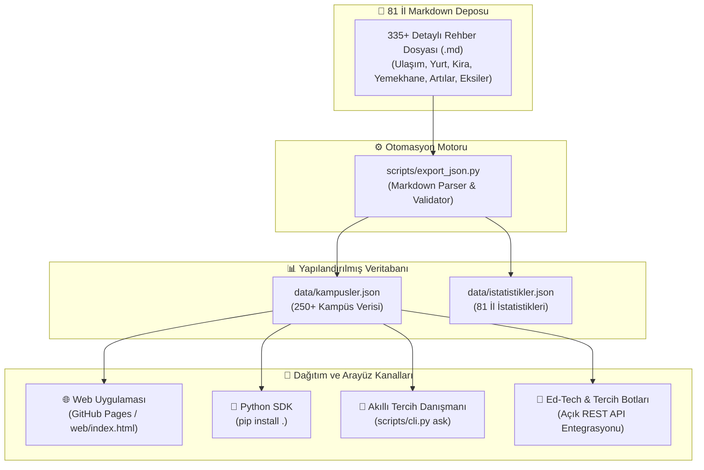

<p align="center">
  
</p>

<p align="center">
  <a href="https://github.com/bahattinyunus/turkiye-kampus-rehberi/actions/workflows/ci.yml">
    
  </a>
  <a href="https://bahattinyunus.github.io/turkiye-kampus-rehberi/">
    
  </a>
  
  
  
  <a href="./LICENSE">
    
  </a>
</p>

<p align="center">
  <strong>Türkiye'deki tüm devlet ve vakıf üniversitelerinin, fakültelerinin ve ilçe yerleşkelerinin gerçek yüzünü yansıtan; öğrenciden öğrenciye, kitle kaynaklı (crowdsourced) ve filtresiz tercih rehberi.</strong>
</p>

<p align="center">
  <a href="#-canlı-web-uygulaması">🌐 Web Uygulaması</a> •
  <a href="#-python-sdk--kütüphane-kullanımı">🐍 Python SDK</a> •
  <a href="#-akıllı-tercih-danışmanı-ai">🤖 AI Tercih Danışmanı</a> •
  <a href="#-81-il-bölge-bazlı-kampüs-indeksi">🗺️ 81 İl İndeksi</a> •
  <a href="#-nasıl-katkıda-bulunabilirim">🤝 Katkıda Bulun</a>
</p>

---

## 📖 Manifesto: Neden Buradayız?

YKS ve yatay geçiş tercih dönemleri, adaylar için bir bilinmezlikler okyanusudur. Üniversitelerin resmi web siteleri; her zaman güneşli kampüs fotoğrafları, en son teknoloji laboratuvarlar ve gülümseyen stok görsellerle doludur. Ancak gerçek hayat her zaman o fotoğraflardaki gibi değildir:

> 🏢 **"Kampüs şehre 30 kilometre uzaklıkta bir dağın başında mı?"**  
> 🚌 **"KYK yurtları fakülteye yürüme mesafesinde mi, yoksa sabahları 45 dakika otobüs/ring kuyruğu mu bekleniyor?"**  
> 🏔️ **"Of, Elmadağ, Menteşe, Bucak, Seyitler gibi ilçe yerleşkeleri merkez kampüsle aynı imkanları sunuyor mu?"**  
> 💸 **"Şehirde yerel halkın öğrenciye yaklaşımı nasıl? Görükle, Kötekli, Bosna Hersek, Kültür gibi öğrenci mahallelerinde kiralar ne durumda?"**

Bu depo; Türkiye'nin dört bir yanındaki KYK yurtlarında kalmış, kampüslerin havasını solumuş öğrencilerin kolektif hafızasıdır. Amacımız, tercih yapacak adaylara **veriye dayalı, objektif ve şeffaf** bir rehber sunmaktır.

<p align="center">
  
</p>

---

## ⚡ Ekosistem ve Mimari

Bu proje yalnızca bir Markdown koleksiyonu değildir; **veri çıkarma motoru, Python kütüphanesi, terminal CLI aracı, JSON API ve modern bir web arayüzünden** oluşan eksiksiz bir açık kaynak ekosistemidir:



---

## 🌐 Canlı Web Uygulaması

Rehberin web sürümü **GitHub Pages** üzerinde canlı olarak yayınlanmaktadır:

👉 **[Web Uygulamasını Aç (bahattinyunus.github.io/turkiye-kampus-rehberi)](https://bahattinyunus.github.io/turkiye-kampus-rehberi/)**

* 🔍 **Anlık Arama:** Üniversite, kampüs adı, fakülte veya anahtar kelimeye göre milisaniyelik filtreleme.
* 📍 **İl ve Tür Filtresi:** 81 il veya Devlet/Vakıf ayrımıyla filtreleme.
* 🏷️ **Hızlı Etiketler:** "Metrolu", "Deniz Kıyısı", "7/24 Kütüphane", "Tıp & Sağlık", "Mühendislik".
* 📊 **Detay Modalı:** Sayfadan ayrılmadan tüm metrikleri, artıları, eksileri ve öğrenci notunu inceleme.
* ⚖️ **Kampüs Kıyaslama:** İki yerleşkeyi seçip yan yana avantajlarını kıyaslama.

<p align="center">
  
</p>

---

## 🐍 Python SDK & Kütüphane Kullanımı

Projeyi doğrudan kendi Python betiklerinize veya Ed-Tech yazılımlarınıza dahil edebilirsiniz:

```bash
# Repoyu kurun
pip install .
```

```python
from kampus_rehberi import KampusRehberi, TercihDanismani

rehber = KampusRehberi()

# 1. Kampüs sorgulama
odtu = rehber.get_by_id("06-Ankara/Cankaya/ODTU-Merkez-Kampusu")
print(f"Kampüs: {odtu.title} | Puan: {odtu.rating}")
print(f"Öğrenci Tavsiyesi: {odtu.student_note}")

# 2. Şehir bazlı arama (Örn: İzmir yerleşkeleri)
izmir_kampusleri = rehber.search(city="35")
for k in izmir_kampusleri:
    print(f"- {k.title} ({k.district})")

# 3. İki kampüsü kıyaslama
karsilastirma = rehber.compare(
    "06-Ankara/Cankaya/ODTU-Merkez-Kampusu",
    "34-Istanbul/Sariyer/ITU-Ayazaga-ve-Macka-Taskisla-Kampusleri"
)
print(karsilastirma["karsilastirma"])
```

---

## 🤖 Akıllı Tercih Danışmanı (CLI)

<p align="center">
  
</p>

Terminal üzerinden doğal dilde tercih soruları sorabilir ve yerleşkeleri kıyaslayabilirsiniz:

```bash
# 🎯 Doğal dilde soru sorarak en uygun kampüsleri bul
python scripts/cli.py ask "Deniz kenarında olan mühendislik kampüsleri"
python scripts/cli.py ask "Ankara'da KYK yurdu kampüs içinde olan üniversiteler"

# ⚖️ İki kampüsü terminalde yan yana kıyasla
python scripts/cli.py compare "06-Ankara/Cankaya/ODTU-Merkez-Kampusu" "34-Istanbul/Sariyer/ITU-Ayazaga-ve-Macka-Taskisla-Kampusleri"

# 📊 Depo istatistiklerini görüntüle
python scripts/cli.py stats

# 🔍 Kampüs ve kelime ara
python scripts/cli.py search "metro"

# 📍 Şehir bazlı listele
python scripts/cli.py city 06

# 🚀 Web arayüzünü yerel sunucuda başlat
python scripts/cli.py serve --port 8000

# 🛡️ Tüm bağlantıların ve Markdown dosyalarının bütünlüğünü test et
python scripts/cli.py validate
```

---

## 🗺️ 81 İl Bölge Bazlı Kampüs İndeksi

Aşağıdaki bölge sekmelerinden ilgilendiğiniz ili seçerek o şehrin genel öğrenci profilini ve ilçe/kampüs detaylarını inceleyebilirsiniz:

<details open>
<summary><strong>🌊 Marmara Bölgesi (11 İl)</strong></summary>

| Plaka | İl Klasörü | Başlıca Üniversiteler | Öne Çıkan Bölgeler |
| :---: | :--- | :--- | :--- |
| **10** | [📂 10-Balikesir](./10-Balikesir/README.md) | Balıkesir Üni. (BAÜN), Bandırma Onyedi Eylül Üni. | Çağış Kampüsü, Bahçelievler, Bandırma |
| **11** | [📂 11-Bilecik](./11-Bilecik/README.md) | Bilecik Şeyh Edebali Üniversitesi | Gülümbe Kampüsü, Pelitözü, Bozüyük |
| **16** | [📂 16-Bursa](./16-Bursa/README.md) | Bursa Uludağ Üni., Bursa Teknik Üni. (BTÜ), Mudanya Üni. | Görükle, Mimar Sinan, İnegöl |
| **17** | [📂 17-Canakkale](./17-Canakkale/README.md) | Çanakkale Onsekiz Mart Üni. (ÇOMÜ) | Terzioğlu, Barbaros, Kepez, Biga |
| **22** | [📂 22-Edirne](./22-Edirne/README.md) | Trakya Üniversitesi | Balkan Yerleşkesi, Ayşekadın, Keşan |
| **34** | [📂 34-Istanbul](./34-Istanbul/README.md) | İTÜ, Boğaziçi, YTÜ, İÜ, İÜC, Marmara, GSÜ, Koç, Sabancı vb. | Ayazağa, Davutpaşa, Beyazıt, Kadıköy, Maltepe |
| **39** | [📂 39-Kirklareli](./39-Kirklareli/README.md) | Kırklareli Üniversitesi | Kayalı Kampüsü, Lüleburgaz |
| **41** | [📂 41-Kocaeli](./41-Kocaeli/README.md) | Kocaeli Üni. (KOÜ), Gebze Teknik Üni. (GTÜ) | Umuttepe, İzmit Merkez, Gebze Çayırova |
| **54** | [📂 54-Sakarya](./54-Sakarya/README.md) | Sakarya Üni. (SAÜ), Sakarya Uygulamalı Bilimler Üni. | Esentepe Kampüsü, Serdivan (Mavi Durak) |
| **59** | [📂 59-Tekirdag](./59-Tekirdag/README.md) | Tekirdağ Namık Kemal Üniversitesi | Değirmenaltı, Çorlu Mühendislik |
| **77** | [📂 77-Yalova](./77-Yalova/README.md) | Yalova Üniversitesi | Merkez Yerleşke, Çınarcık |

</details>

<details>
<summary><strong>🌿 Ege Bölgesi (8 İl)</strong></summary>

| Plaka | İl Klasörü | Başlıca Üniversiteler | Öne Çıkan Bölgeler |
| :---: | :--- | :--- | :--- |
| **09** | [📂 09-Aydin](./09-Aydin/README.md) | Aydın Adnan Menderes Üniversitesi (ADÜ) | Aytepe (Efeler), Nazilli İsabeyli, Kuşadası |
| **20** | [📂 20-Denizli](./20-Denizli/README.md) | Pamukkale Üniversitesi (PAÜ) | Kınıklı Kampüsü, Asmalıevler, Bağbaşı |
| **35** | [📂 35-Izmir](./35-Izmir/README.md) | Ege Üni., Dokuz Eylül, İYTE, İKÇÜ, Bakırçay, Ekonomi, Yaşar | Bornova (Küçükpark), Buca (Tınaztepe), Urla |
| **43** | [📂 43-Kutahya](./43-Kutahya/README.md) | Kütahya Dumlupınar Üni., Kütahya Sağlık Bilimleri | Evliya Çelebi Kampüsü, Germiyan, Tavşanlı |
| **45** | [📂 45-Manisa](./45-Manisa/README.md) | Manisa Celal Bayar Üniversitesi (MCBÜ) | Muradiye Kampüsü, Uncubozköy, Turgutlu |
| **48** | [📂 48-Mugla](./48-Mugla/README.md) | Muğla Sıtkı Koçman Üniversitesi (MSKÜ) | Kötekli (Menteşe), Bodrum, Fethiye, Marmaris |
| **64** | [📂 64-Usak](./64-Usak/README.md) | Uşak Üniversitesi | Bir Eylül Kampüsü, Kemalöz |
| **35** | [📂 35-Izmir](./35-Izmir/README.md) | Ege, DEÜ, İYTE, İKÇÜ, Bakırçay, Ekonomi, Demokrasi | Bornova, Buca, Urla Gülbahçe, Çiğli |

</details>

<details>
<summary><strong>🏛️ İç Anadolu Bölgesi (13 İl)</strong></summary>

| Plaka | İl Klasörü | Başlıca Üniversiteler | Öne Çıkan Bölgeler |
| :---: | :--- | :--- | :--- |
| **06** | [📂 06-Ankara](./06-Ankara/README.md) | ODTÜ, Hacettepe, Ankara Üni., Gazi, AYBÜ, Bilkent, TOBB ETÜ | Çankaya, Beytepe, Beşevler, Cebeci, 100. Yıl |
| **18** | [📂 18-Cankiri](./18-Cankiri/README.md) | Çankırı Karatekin Üniversitesi | Uluyazı Kampüsü, Kırkevler |
| **26** | [📂 26-Eskisehir](./26-Eskisehir/README.md) | Anadolu Üni., Eskişehir Osmangazi Üni., ESTÜ | Bağlar, Meşelik (Odunpazarı), İki Eylül |
| **38** | [📂 38-Kayseri](./38-Kayseri/README.md) | Erciyes Üni. (ERÜ), Abdullah Gül Üni. (AGÜ), Kayseri Üni. | Talas, Melikgazi, Sümer Kampüsü |
| **40** | [📂 40-Kirsehir](./40-Kirsehir/README.md) | Kırşehir Ahi Evran Üniversitesi | Bağbaşı Kampüsü, Cacabey |
| **42** | [📂 42-Konya](./42-Konya/README.md) | Selçuk Üni., Necmettin Erbakan Üni., Konya Teknik Üni. | Bosna Hersek (Selçuklu), Köyceğiz (Meram) |
| **50** | [📂 50-Nevsehir](./50-Nevsehir/README.md) | Nevşehir Hacı Bektaş Veli Üni., Kapadokya Üni. | 2000 Evler, Ürgüp Mustafapaşa |
| **51** | [📂 51-Nigde](./51-Nigde/README.md) | Niğde Ömer Halisdemir Üniversitesi | Bor Yolu Kampüsü, Aşağı Kayabaşı |
| **58** | [📂 58-Sivas](./58-Sivas/README.md) | Sivas Cumhuriyet Üni., Sivas Bilim ve Teknoloji Üni. | Merkez Kampüs, Yenişehir |
| **66** | [📂 66-Yozgat](./66-Yozgat/README.md) | Yozgat Bozok Üniversitesi | Erdoğan Akdağ Kampüsü |
| **68** | [📂 68-Aksaray](./68-Aksaray/README.md) | Aksaray Üniversitesi | Adana Yolu Kampüsü, Kafeler Caddesi |
| **70** | [📂 70-Karaman](./70-Karaman/README.md) | Karamanoğlu Mehmetbey Üniversitesi | Yunus Emre Kampüsü |
| **71** | [📂 71-Kirikkale](./71-Kirikkale/README.md) | Kırıkkale Üniversitesi (KKÜ) | Yahşihan Merkez Kampüsü, Yenişehir |

</details>

<details>
<summary><strong>🌴 Akdeniz Bölgesi (8 İl)</strong></summary>

| Plaka | İl Klasörü | Başlıca Üniversiteler | Öne Çıkan Bölgeler |
| :---: | :--- | :--- | :--- |
| **01** | [📂 01-Adana](./01-Adana/README.md) | Çukurova Üni., Adana Alparslan Türkeş BTÜ | Balcalı, Barajyolu, Sarıçam |
| **07** | [📂 07-Antalya](./07-Antalya/README.md) | Akdeniz Üni., ALKÜ, Antalya Bilim Üni. | Kültür Mahallesi, Meltem, Alanya Kestel |
| **15** | [📂 15-Burdur](./15-Burdur/README.md) | Burdur Mehmet Akif Ersoy Üni. (MAKÜ) | İstiklal Yerleşkesi, Bucak |
| **31** | [📂 31-Hatay](./31-Hatay/README.md) | Hatay Mustafa Kemal Üni., İskenderun Teknik Üni. | Tayfur Sökmen, İskenderun Merkez |
| **32** | [📂 32-Isparta](./32-Isparta/README.md) | Süleyman Demirel Üni., Isparta Uygulamalı Bilimler | Çünür Doğu/Batı Kampüsü, Fatih Mah. |
| **33** | [📂 33-Mersin](./33-Mersin/README.md) | Mersin Üni. (MEÜ), Tarsus Üni., Toros, Çağ | Çiftlikköy, Üniversite Caddesi, Tarsus |
| **46** | [📂 46-Kahramanmaras](./46-Kahramanmaras/README.md) | Kahramanmaraş Sütçü İmam Üni., İstiklal Üni. | Avşar Kampüsü, Karacasu |
| **80** | [📂 80-Osmaniye](./80-Osmaniye/README.md) | Osmaniye Korkut Ata Üniversitesi | Karacaoğlan Kampüsü (Fakıuşağı) |

</details>

<details>
<summary><strong>🌲 Karadeniz Bölgesi (18 İl)</strong></summary>

| Plaka | İl Klasörü | Başlıca Üniversiteler | Öne Çıkan Bölgeler |
| :---: | :--- | :--- | :--- |
| **05** | [📂 05-Amasya](./05-Amasya/README.md) | Amasya Üniversitesi | İpekköy, Yeşilırmak, Merzifon |
| **08** | [📂 08-Artvin](./08-Artvin/README.md) | Artvin Çoruh Üniversitesi | Seyitler Kampüsü, Hopa |
| **14** | [📂 14-Bolu](./14-Bolu/README.md) | Bolu Abant İzzet Baysal Üniversitesi | Gölköy Kampüsü, İzzet Baysal Cad. |
| **19** | [📂 19-Corum](./19-Corum/README.md) | Hitit Üniversitesi | Kuzey Kampüsü, Güney Kampüsü |
| **28** | [📂 28-Giresun](./28-Giresun/README.md) | Giresun Üniversitesi | Güre Yerleşkesi, Tirebolu |
| **29** | [📂 29-Gumushane](./29-Gumushane/README.md) | Gümüşhane Üniversitesi | Bağlarbaşı Kampüsü |
| **37** | [📂 37-Kastamonu](./37-Kastamonu/README.md) | Kastamonu Üniversitesi | Kuzeykent Kampüsü |
| **52** | [📂 52-Ordu](./52-Ordu/README.md) | Ordu Üniversitesi | Cumhuriyet Kampüsü, Ünye, Fatsa |
| **53** | [📂 53-Rize](./53-Rize/README.md) | Recep Tayyip Erdoğan Üniversitesi | Zihni Derin (Fener), Çayeli |
| **55** | [📂 55-Samsun](./55-Samsun/README.md) | Ondokuz Mayıs Üni. (OMÜ), Samsun Üni. | Kurupelit (Atakum), Ballıca |
| **57** | [📂 57-Sinop](./57-Sinop/README.md) | Sinop Üniversitesi | Osmaniye/Korucuk Kampüsü |
| **60** | [📂 60-Tokat](./60-Tokat/README.md) | Tokat Gaziosmanpaşa Üniversitesi | Taşlıçiftlik Kampüsü |
| **61** | [📂 61-Trabzon](./61-Trabzon/README.md) | Karadeniz Teknik Üni. (KTÜ), Trabzon Üni. | Kanuni (Kalkınma), Akçaabat, Of |
| **67** | [📂 67-Zonguldak](./67-Zonguldak/README.md) | Zonguldak Bülent Ecevit Üniversitesi | Farabi (İncivez), Kdz. Ereğli |
| **69** | [📂 69-Bayburt](./69-Bayburt/README.md) | Bayburt Üniversitesi | Dede Korkut Kampüsü, Baberti |
| **74** | [📂 74-Bartin](./74-Bartin/README.md) | Bartın Üniversitesi | Kutlubey Kampüsü, Ağdacı |
| **78** | [📂 78-Karabuk](./78-Karabuk/README.md) | Karabük Üniversitesi (KBÜ) | Demir Çelik Kampüsü, 100. Yıl |
| **81** | [📂 81-Duzce](./81-Duzce/README.md) | Düzce Üniversitesi | Konuralp Merkez Kampüsü, Akçakoca |

</details>

<details>
<summary><strong>🏔️ Doğu Anadolu Bölgesi (14 İl)</strong></summary>

| Plaka | İl Klasörü | Başlıca Üniversiteler | Öne Çıkan Bölgeler |
| :---: | :--- | :--- | :--- |
| **04** | [📂 04-Agri](./04-Agri/README.md) | Ağrı İbrahim Çeçen Üniversitesi | Merkez Kampüs |
| **12** | [📂 12-Bingol](./12-Bingol/README.md) | Bingöl Üniversitesi | Selahaddin-i Eyyubi Mah. |
| **13** | [📂 13-Bitlis](./13-Bitlis/README.md) | Bitlis Eren Üniversitesi | Rahva Merkez Kampüsü, Tatvan |
| **23** | [📂 23-Elazig](./23-Elazig/README.md) | Fırat Üniversitesi | Üniversite Mahallesi, Sürsürü |
| **24** | [📂 24-Erzincan](./24-Erzincan/README.md) | Erzincan Binali Yıldırım Üniversitesi | Yalnızbağ Yerleşkesi |
| **25** | [📂 25-Erzurum](./25-Erzurum/README.md) | Atatürk Üni., Erzurum Teknik Üni. (ETÜ) | Yakutiye Merkez Kampüs, Yıldızkent |
| **30** | [📂 30-Hakkari](./30-Hakkari/README.md) | Hakkari Üniversitesi | Zeynel Bey Kampüsü |
| **36** | [📂 36-Kars](./36-Kars/README.md) | Kafkas Üniversitesi | Paşaçayırı Kampüsü, Sarıkamış |
| **44** | [📂 44-Malatya](./44-Malatya/README.md) | İnönü Üni., Malatya Turgut Özal Üni. | Battalgazi (Bulgurlu), Yeşilyurt |
| **49** | [📂 49-Mus](./49-Mus/README.md) | Muş Alparslan Üniversitesi | Güzeltepe Kampüsü |
| **62** | [📂 62-Tunceli](./62-Tunceli/README.md) | Munzur Üniversitesi | Aktuluk Yerleşkesi, Pertek |
| **65** | [📂 65-Van](./65-Van/README.md) | Van Yüzüncü Yıl Üniversitesi | Zeve Kampüsü (Tuşba) |
| **75** | [📂 75-Ardahan](./75-Ardahan/README.md) | Ardahan Üniversitesi | Yenisey Kampüsü |
| **76** | [📂 76-Igdir](./76-Igdir/README.md) | Iğdır Üniversitesi | Suveren Kampüsü, Karaağaç |

</details>

<details>
<summary><strong>☀️ Güneydoğu Anadolu Bölgesi (9 İl)</strong></summary>

| Plaka | İl Klasörü | Başlıca Üniversiteler | Öne Çıkan Bölgeler |
| :---: | :--- | :--- | :--- |
| **02** | [📂 02-Adiyaman](./02-Adiyaman/README.md) | Adıyaman Üniversitesi | Altınşehir Mahallesi |
| **21** | [📂 21-Diyarbakir](./21-Diyarbakir/README.md) | Dicle Üniversitesi | Sur Kampüsü, Kayapınar |
| **27** | [📂 27-Gaziantep](./27-Gaziantep/README.md) | Gaziantep Üni. (GAÜN), GİBTÜ, Hasan Kalyoncu | Üniversite Bulvarı, Karataş |
| **47** | [📂 47-Mardin](./47-Mardin/README.md) | Mardin Artuklu Üniversitesi | Artuklu Kampüsü, Midyat |
| **56** | [📂 56-Siirt](./56-Siirt/README.md) | Siirt Üniversitesi | Kezer Yerleşkesi |
| **63** | [📂 63-Sanliurfa](./63-Sanliurfa/README.md) | Harran Üniversitesi | Osmanbey Kampüsü, Eyyübiye |
| **72** | [📂 72-Batman](./72-Batman/README.md) | Batman Üniversitesi | Batı Raman Kampüsü, Merkez |
| **73** | [📂 73-Sirnak](./73-Sirnak/README.md) | Şırnak Üniversitesi | Mehmet Emin Acar Kampüsü |
| **79** | [📂 79-Kilis](./79-Kilis/README.md) | Kilis 7 Aralık Üniversitesi | Merkez Kampüs, Karataş |

</details>

---

## 🔍 İçerik Standartları: Bir Kampüs Rehberinde Neler Var?

Her yerleşke dosyası [`TEMPLATE.md`](./TEMPLATE.md) şablonundaki standart metrikleri içerir:

1. **🚇 Ulaşım Ağı ve Erişilebilirlik:** Şehir merkezine mesafe, ring seferleri, metro/tramvay entegrasyonu, öğrenci abonman ücretleri ve kış koşullarında ulaşım.
2. **🏠 Barınma ve Yurtlar:** KYK yurtlarının kapasitesi ve konumu, özel yurt fiyat bantları, popüler öğrenci mahalleleri ve güncel kira ortalamaları.
3. **🎓 Akademik & Fiziki Altyapı:** Kütüphane kapasitesi (Vize/final haftası 7/24 açık mı?), laboratuvar/atölye imkanları, internet (`eduroam`) hızı ve öğrenci kulüpleri.
4. **🍽️ Beslenme ve Kampüs Hayatı:** Yemekhane ücretleri, porsiyon doyuruculuğu, alternatif kafeteryalar, çarşı ve spor tesisleri.
5. **🌆 Şehir ve İlçe Dinamikleri:** Yerel halkın öğrenciye tutumu, sosyal etkinlikler, doğa/kültür imkanları, part-time iş/staj olanakları.
6. **⚖️ Artılar ve Eksiler:** Filtresiz en büyük avantajlar ve dezavantajlar.
7. **💬 Öğrenci Tavsiyesi:** Bu kampüste okuyan bir üst dönem öğrencisinin samimi ve nokta atışı tavsiyesi.

---

## 🤝 Nasıl Katkıda Bulunabilirim?

Bu repo tamamen açık kaynaktır ve senin deneyimlerine ihtiyacı var! Kendi üniversiteni veya çok iyi bildiğin bir kampüsü ekleyebilirsin. Detaylar için [`CONTRIBUTING.md`](./CONTRIBUTING.md) belgesini inceleyebilirsin.

```bash
# 1. Repoyu klonla
git clone https://github.com/bahattinyunus/turkiye-kampus-rehberi.git
cd turkiye-kampus-rehberi

# 2. Yeni bir dal oluştur
git checkout -b feat/kampus-ekle

# 3. TEMPLATE.md dosyasını ilgili ile kopyalayıp doldur
cp TEMPLATE.md 06-Ankara/Cankaya/Yeni-Kampus.md

# 4. Doğrula ve Commit at
python scripts/cli.py validate
git add .
git commit -m "feat(06-Ankara): Yeni Kampüs Rehberi eklendi"
git push origin feat/kampus-ekle
```

---

## 🚀 Proje Yol Haritası (Roadmap)

- [x] Temel depo mimarisinin ve klasör yapısının (81 İl) oluşturulması.
- [x] Standart Markdown şablonlarının ([`TEMPLATE.md`](./TEMPLATE.md), [`CONTRIBUTING.md`](./CONTRIBUTING.md), [`CODE_OF_CONDUCT.md`](./CODE_OF_CONDUCT.md)) yazılması.
- [x] 81 ilin tamamı için şehir rehberlerinin ve 250+ kampüs analizinin tamamlanması.
- [x] **Web Entegrasyonu (Faz 2):** GitHub Pages üzerinde canlı, filtreleme destekli arama motoru ([`web/index.html`](https://bahattinyunus.github.io/turkiye-kampus-rehberi/)).
- [x] **API ve SDK (Faz 3):** `kampus-rehberi` Python paketi ve yapılandırılmış JSON veritabanı ([`data/kampusler.json`](./data/kampusler.json)).
- [x] **Akıllı Tercih Danışmanı (Faz 4):** Doğal dilde soru sorulabilen AI destekli `TercihDanismani` motoru.
- [ ] **Mobil Uygulama (Faz 5):** React Native / Flutter tabanlı çevrimdışı destekli mobil tercih asistanı.

---

## 📞 İletişim ve Topluluk

* 💡 **Tartışmalar:** Fikirler ve öneriler için [GitHub Discussions](https://github.com/bahattinyunus/turkiye-kampus-rehberi/discussions)
* 🐛 **Hata Bildirimi:** Eksik veya hatalı veriler için [GitHub Issues](https://github.com/bahattinyunus/turkiye-kampus-rehberi/issues)
* 📧 **E-Posta:** `bahattinyunuscetin@hotmail.com`

<p align="center">
  <sub>Türkiye Kampüs Rehberi © 2026. MIT Lisansı ile açık kaynak olarak geliştirilmiştir.</sub><br/>
  <sub><em>"Resmi kataloglar binaları gösterir, açık kaynak kültürü ise o binaların içindeki gerçeği."</em></sub>
</p>
