<p align="center">
  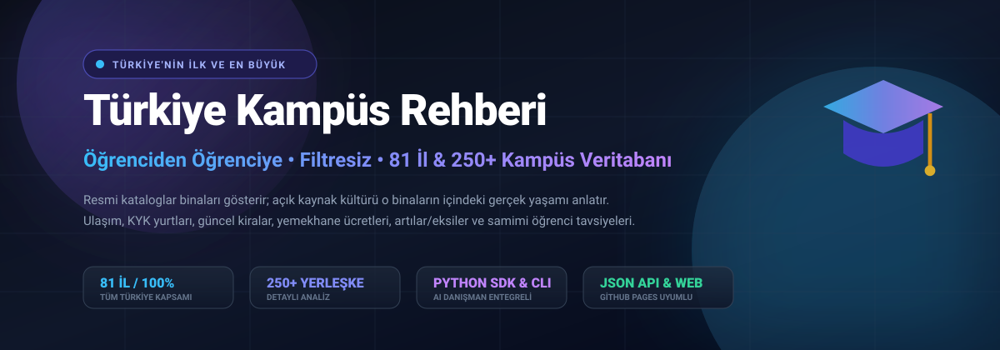
</p>

<p align="center">
  <a href="https://github.com/bahattinyunus/turkiye-kampus-rehberi/actions/workflows/ci.yml">
    
  </a>
  <a href="https://bahattinyunus.github.io/turkiye-kampus-rehberi/">
    
  </a>
  
  
  
  <a href="./LICENSE">
    
  </a>
</p>

<p align="center">
  <strong>Türkiye'deki tüm devlet ve vakıf üniversitelerinin, fakültelerinin ve ilçe yerleşkelerinin gerçek yüzünü yansıtan; öğrenciden öğrenciye, kitle kaynaklı (crowdsourced) ve filtresiz tercih rehberi.</strong>
</p>

<p align="center">
  <a href="#-türkiyenin-zirvedeki-10-kampüsü-detaylı-inceleme">🏆 Zirvedeki 10 Kampüs</a> •
  <a href="#-tercih-yapmadan-önce-okuyun-kampüslerin-kronik-sorunları-ve-olumsuz-öğrenci-yorumları">⚠️ Kronik Sorunlar</a> •
  <a href="#-canlı-web-uygulaması">🌐 Web Uygulaması</a> •
  <a href="#-python-sdk--kütüphane-kullanımı">🐍 Python SDK</a> •
  <a href="#-akıllı-tercih-danışmanı-ai">🤖 AI Tercih Danışmanı</a> •
  <a href="#-81-il-bölge-bazlı-kampüs-indeksi">🗺️ 81 İl İndeksi</a> •
  <a href="#-nasıl-katkıda-bulunabilirim">🤝 Katkıda Bulun</a>
</p>

---

## 📖 Manifesto: Neden Buradayız?

YKS ve yatay geçiş tercih dönemleri, adaylar için bir bilinmezlikler okyanusudur. Üniversitelerin resmi web siteleri; her zaman güneşli kampüs fotoğrafları, en son teknoloji laboratuvarlar ve gülümseyen stok görsellerle doludur. Ancak gerçek hayat her zaman o fotoğraflardaki gibi değildir:

> 🏢 **"Kampüs şehre 30 kilometre uzaklıkta bir dağın başında mı?"**  
> 🚌 **"KYK yurtları fakülteye yürüme mesafesinde mi, yoksa sabahları 45 dakika otobüs/ring kuyruğu mu bekleniyor?"**  
> 🏔️ **"Of, Elmadağ, Menteşe, Bucak, Seyitler gibi ilçe yerleşkeleri merkez kampüsle aynı imkanları sunuyor mu?"**  
> 💸 **"Şehirde yerel halkın öğrenciye yaklaşımı nasıl? Görükle, Kötekli, Bosna Hersek, Kültür gibi öğrenci mahallelerinde kiralar ne durumda?"**

Bu depo; Türkiye'nin dört bir yanındaki KYK yurtlarında kalmış, kampüslerin havasını solumuş öğrencilerin kolektif hafızasıdır. Amacımız, tercih yapacak adaylara **veriye dayalı, objektif ve şeffaf** bir rehber sunmaktır.

<p align="center">
  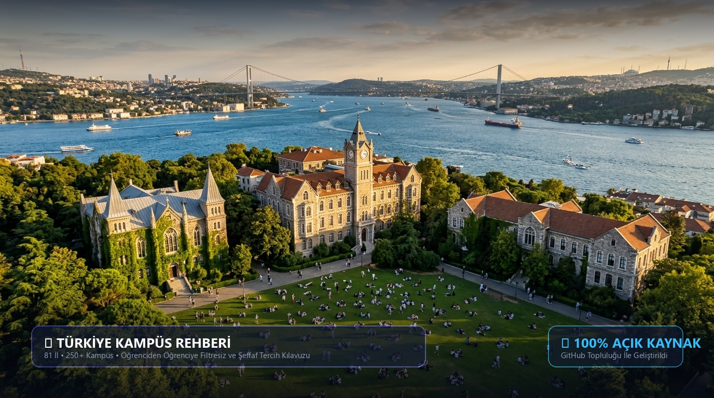
</p>

---

## ⚡ Ekosistem ve Mimari

Bu proje yalnızca bir Markdown koleksiyonu değildir; **veri çıkarma motoru, Python kütüphanesi, terminal CLI aracı, JSON API ve modern bir web arayüzünden** oluşan eksiksiz bir açık kaynak ekosistemidir:

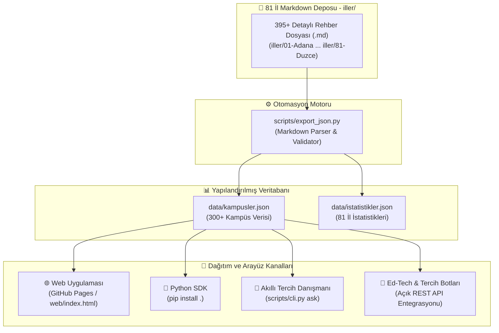

### 📁 Modüler Dizin Mimarisi

Depo, 81 il klasörünün `iller/` dizini altında toplanmasıyla tertemiz, sade ve modüler bir mimariye kavuşturulmuştur:

```text
turkiye-kampus-rehberi/
├── 📁 iller/                   # 81 İl Klasörleri (iller/01-Adana ... iller/81-Duzce)
│   ├── 📁 06-Ankara/
│   │   ├── README.md           # Ankara Genel Şehir & Öğrenci Rehberi
│   │   ├── 📁 Cankaya/         # İlçe Dizinleri ve Kampüs Dosyaları
│   │   └── ...
│   ├── 📁 34-Istanbul/
│   └── 📁 35-Izmir/
├── 📁 data/                    # Yapılandırılmış JSON Veritabanı (kampusler.json, istatistikler.json)
├── 📁 kampus_rehberi/          # Python SDK ve CLI Çekirdek Paketi
├── 📁 scripts/                 # CLI Araçları, Doğrulayıcılar ve Export Motoru
├── 📁 web/                     # GitHub Pages Etkileşimli Arama ve Filtreleme Portalı
├── 📁 tests/                   # Otomatik Birim (Unit) Testleri
├── 📁 assets/                  # Afişler, İnfografikler ve Kampüs Görselleri
├── CONTRIBUTING.md             # Katkıda Bulunma Kılavuzu
├── TEMPLATE.md                 # Standart Kampüs İnceleme Şablonu
└── README.md                   # Ana Dokümantasyon ve İndeks Portalı
```

---

## 🌐 Canlı Web Portalı (v2.0 Pro)

Rehberin web sürümü **GitHub Pages** üzerinde canlı olarak yayınlanmaktadır:

👉 **[Web Portalı Aç (bahattinyunus.github.io/turkiye-kampus-rehberi)](https://bahattinyunus.github.io/turkiye-kampus-rehberi/)**

* 🗺️ **81 İl & 7 Coğrafi Bölge Harita Seçicisi:** Marmara, Ege, İç Anadolu ve tüm bölgeleri tek tıkla filtreleyip keşfetme.
* ⚖️ **Çift Kampüs Yan Yana Kıyaslama:** İki yerleşkeyi seçip tüm metriklerini, puanlarını, yurt/ulaşım farklarını yan yana tablolarda kıyaslama.
* 🤖 **Akıllı Tercih Danışmanı Modalı:** Doğal dilde tercih sorusu sorarak anlık % uyum puanı ve eşleşme nedenlerini görme.
* ❤️ **Favoriler Sistemi (Bookmarks):** Beğendiğiniz kampüsleri yerel hafızaya kaydedip sadece favorilerinizi görüntüleme ve tek tıkla indirme.
* 🎲 **Rastgele Kampüs Keşfi:** Kararsız kalanlar için tek tıkla şansına kampüs önerme motoru.
* 📥 **JSON & CSV Dışa Aktarma:** Seçili veya filtrelenmiş kampüs listesini anında Excel/CSV veya JSON formatında indirme.
* 🔗 **Doğrudan Paylaşım Linki (Deep-linking):** Belirli bir kampüsü veya şehri URL parametreleriyle (`?kampus=...`) doğrudan paylaşabilme.

<p align="center">
  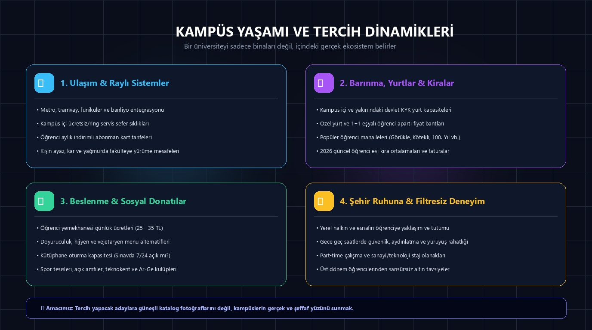
</p>

---

## 🐍 Python SDK & Kütüphane Kullanımı (v2.0)

Projeyi doğrudan kendi Python betiklerinize veya Ed-Tech yazılımlarınıza dahil edebilirsiniz:

```bash
# Repoyu kurun (veya geliştirici modunda)
pip install -e .
```

```python
from kampus_rehberi import KampusRehberi, TercihDanismani, run_api_server

rehber = KampusRehberi()

# 1. Kampüs sorgulama & özet kart
odtu = rehber.get_by_id("06-Ankara/Cankaya/ODTU-Merkez-Kampusu")
print(f"Kampüs: {odtu.title} | Puan: {odtu.rating_num}/5.0")
print(odtu.to_markdown())

# 2. Şehir bazlı arama ve puana göre sıralama
izmir_kampusleri = rehber.search(city="35", min_rating=4.2, sort_by="rating_desc")
for k in izmir_kampusleri:
    print(f"- {k.title} ({k.district}) -> {k.rating_num}/5.0")

# 3. Zirvedeki kampüsleri listeleme & Rastgele seçim
top10 = rehber.get_top_rated(n=10)
sans_kampusu = rehber.get_random()

# 4. İki kampüsü kıyaslama
karsilastirma = rehber.compare(
    "06-Ankara/Cankaya/ODTU-Merkez-Kampusu",
    "34-Istanbul/Sariyer/ITU-Ayazaga-ve-Macka-Taskisla-Kampusleri"
)

# 5. CSV veya Markdown olarak dışa aktarma
rehber.export(format="csv", output_path="kampusler.csv")

# 6. Akıllı Tercih Danışmanı
danisman = TercihDanismani(rehber)
oneriler = danisman.danis("Deniz kıyısında, metroya yakın mühendislik fakülteleri", top_k=3)
for o in oneriler:
    print(f"{o['kampus']} -> Uyum: {o['uyum_yuzdesi']} | Nedenler: {o['eslesen_kriterler']}")
```

---

## 📡 Dahili REST API Sunucusu

Proje, harici bir framework (Flask/FastAPI) kurma zorunluluğu olmadan, standart Python ortamında çalışan yüksek performanslı ve CORS destekli bir REST API içerir:

```bash
# REST API ve Web Portalını Başlat
kampus-rehberi serve --port 8000
# veya
python scripts/cli.py serve --port 8000
```

### 🔗 API Uç Noktaları (Endpoints):

| Uç Nokta (Endpoint) | Açıklama ve Parametreler |
| :--- | :--- |
| `GET /api/stats` | Toplam kampüs sayısı, il sayısı ve tür dağılımları |
| `GET /api/cities` | 81 ilin kampüs sayılarıyla birlikte tam listesi |
| `GET /api/campuses` | Filtreli liste (`?city=Ankara&type=Devlet&min_rating=4.5&sort_by=rating_desc`) |
| `GET /api/campuses/{id}` | Tek bir kampüsün tüm metrikleri, artıları, eksileri ve özetleri |
| `GET /api/advisor?q=...` | Doğal dil soru analizi ve % uyum skorlarıyla öneri listesi |
| `GET /api/compare?c1=...&c2=...` | İki kampüsün yan yana metrik ve avantaj kıyaslaması |
| `GET /api/random` | Rastgele 1 veya N adet kampüs (`?count=3`) |

---

## 🤖 Akıllı Tercih Danışmanı (CLI)

<p align="center">
  
</p>

Terminal üzerinden doğal dilde tercih soruları sorabilir ve yerleşkeleri kıyaslayabilirsiniz:

```bash
# 🎯 Doğal dilde soru sorarak en uygun kampüsleri puanla
kampus-rehberi ask "Deniz kenarında olan mühendislik kampüsleri"
kampus-rehberi ask "Ankara'da KYK yurdu kampüs içinde olan üniversiteler"

# 🧙 İnteraktif Tercih Sihirbazı (Adım Adım Soru-Cevap)
kampus-rehberi wizard

# 🏆 En yüksek puanlı 10 kampüsü listele (İsteğe bağlı il filtresi)
kampus-rehberi top -n 10
kampus-rehberi top -n 5 --city "34"

# 🎲 Rastgele bir kampüs kartı keşfet
kampus-rehberi random

# ⚖️ İki kampüsü terminalde yan yana kıyasla
kampus-rehberi compare "06-Ankara/Cankaya/ODTU-Merkez-Kampusu" "34-Istanbul/Sariyer/ITU-Ayazaga-ve-Macka-Taskisla-Kampusleri"

# 📥 Verileri dışa aktar (JSON, CSV veya Markdown)
kampus-rehberi export --format csv -o liste.csv
kampus-rehberi export --format md -o liste.md

# 📊 Depo istatistiklerini görüntüle
kampus-rehberi stats

# 🔍 Filtreli arama ve sıralama
kampus-rehberi search "metro" --city "06" --sort rating_desc

# 🚀 Web portalı ve REST API'yi yerelde aç
kampus-rehberi serve --port 8000

# 🛡️ Kalite ve Format Kontrolleri (Linter & Bağlantı Doğrulayıcı)
python scripts/cli.py validate
python scripts/validate_campuses.py
```

---


---

## 🏆 Türkiye'nin Zirvedeki 10 Kampüsü (Detaylı İnceleme)

Öğrenci dostu endeksi, akademik araştırma altyapısı, ulaşım kolaylığı, barınma imkanları ve eşsiz kampüs kültürleriyle öne çıkan Türkiye'nin en seçkin 10 yerleşkesi:

---

### 1. 🌲 Orta Doğu Teknik Üniversitesi (ODTÜ) - Merkez Kampüsü (Ankara / Çankaya)

<p align="center">
  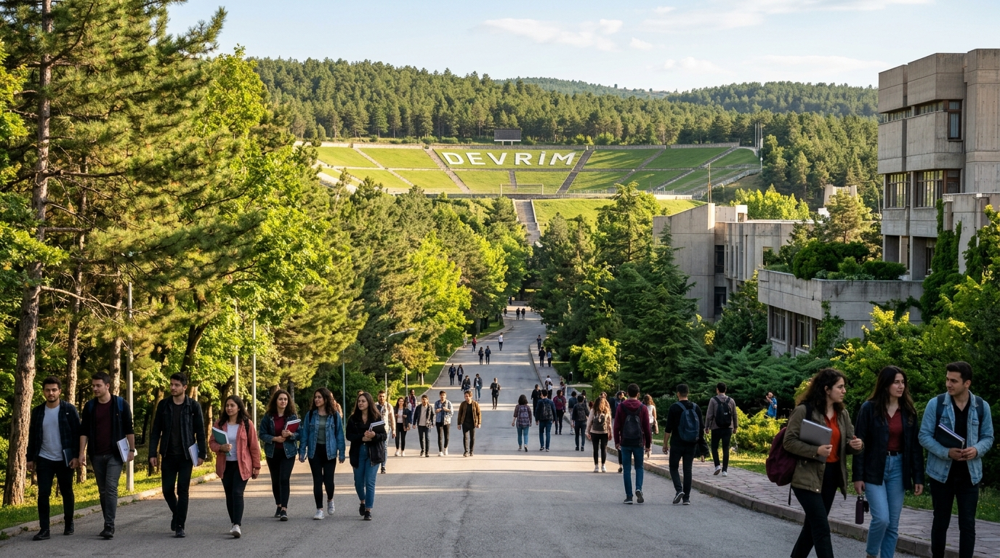
</p>

* **Şehir / İlçe:** Ankara / Çankaya
* **Tür:** Devlet Araştırma Üniversitesi
* **Öğrenci Dostu Puanı:** ⭐️⭐️⭐️⭐️⭐️ (4.9 / 5.0)
* **Ulaşım:** M2 Çayyolu Metrosu (ODTÜ İstasyonu) doğrudan nizamiyededir; A1, A4 kapıları ve yurtlar bölgesi arasında kesintisiz ring seferleri çalışır.
* **Barınma & Yaşam:** Kampüs içinde 19 kız/erkek öğrenci yurdu mevcuttur. 100. Yıl Mahallesi, ODTÜ öğrencilerinin yürüme mesafesinde yaşadığı bağımsız bir kültür merkezidir.
* **Karakteristik Ruh:** Efsanevi **Devrim Stadyumu**, orman içi **Alle yürüyüş yolu**, Türkiye'nin ilk teknokenti **ODTÜ Teknokent** ve profesörden öğrenciye herkesin birbirine eşitlikle yaklaştığı meşhur *"Hocam"* kültürü.
* 💬 **Öğrenci Tavsiyesi:** *"ODTÜ'de okumak bir diplomadan öte ömürlük bir aidiyettir. Bahar Şenliği'nde Devrim çimlerine uzanıp gökyüzünü izlemeden, Oryantasyon günlerinde topluluk stantlarını gezmeden asla mezun olma!"*
* 📖 [**Tam ODTÜ Merkez Kampüs Rehberini Oku ➔**](./iller/06-Ankara/Cankaya/ODTU-Merkez-Kampusu.md)

---

### 2. 🌊 Boğaziçi Üniversitesi - Güney, Kuzey ve Hisar Kampüsleri (İstanbul / Beşiktaş)

<p align="center">
  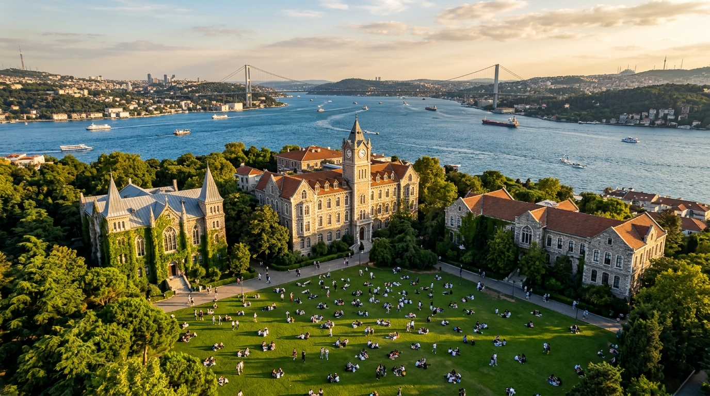
</p>

* **Şehir / İlçe:** İstanbul / Beşiktaş (Bebek / Rumelihisarı)
* **Tür:** Devlet Araştırma Üniversitesi
* **Öğrenci Dostu Puanı:** ⭐️⭐️⭐️⭐️⭐️ (4.7 / 5.0)
* **Ulaşım:** M6 Levent-Boğaziçi Metrosu ve F4 Boğaziçi-Aşiyan Füniküleri kapıdadır; Aşiyan İskelesi'nden vapurla Üsküdar/Kadıköy 10-15 dakikadır.
* **Barınma & Yaşam:** Kuzey ve Kilyos kampüslerinde yurtlar yer alır; Hisarüstü (Rumelihisarı) mahallesi tamamen öğrencilerin kafe ve ev hayatıyla örülüdür.
* **Karakteristik Ruh:** Tarihi sarmaşıklı taş binalar, Albert Long Hall klasik müzik konserleri, dünyanın en güzel manzaralarından biri olan **Güney Çimler** ve efsanevi öğrenci kulüpleri (BÜDAK, Taşoda, COMPEC, BÜİK).
* 💬 **Öğrenci Tavsiyesi:** *"Boğaziçi'nde ders aralarında Güney Çimler'de kedilerle oturup Boğaz'ı izlemek bütün sınav stresini siler. Hazırlıkta Kilyos'a düşersen hiç üzülme, en sıkı dostluklar o sahil kampüsünde kurulur!"*
* 📖 [**Tam Boğaziçi Üniversitesi Kampüs Rehberini Oku ➔**](./iller/34-Istanbul/Besiktas/Bogazici-Universitesi-Guney-Kuzey-ve-Kilyos-Kampusleri.md)

---

### 3. ⚙️ İstanbul Teknik Üniversitesi (İTÜ) - Ayazağa ve Maçka Kampüsleri (İstanbul / Sarıyer)

<p align="center">
  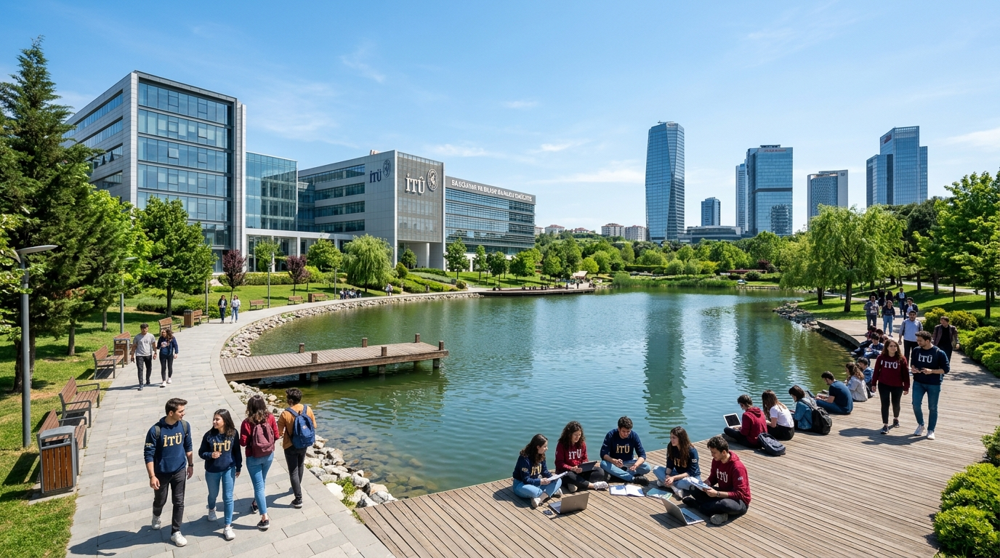
</p>

* **Şehir / İlçe:** İstanbul / Sarıyer (Maslak)
* **Tür:** Devlet Teknik Araştırma Üniversitesi
* **Öğrenci Dostu Puanı:** ⭐️⭐️⭐️⭐️⭐️ (4.8 / 5.0)
* **Ulaşım:** M2 Yenikapı-Hacıosman Metrosu (İTÜ-Ayazağa Durağı) doğrudan kampüs nizamiyesine açılır; Maslak plazalar bölgesine komşudur.
* **Barınma & Yaşam:** Kampüs içinde Vadi Yurtları, Gölet Yurtları ve kız/erkek KYK yurtları yer alır; Ayazağa Göleti çevresi öğrencilerin spor ve dinlenme alanıdır.
* **Karakteristik Ruh:** 250 yıllık mühendislik geleneği, dünya çapında akredite diplomalar (ABET), Türkiye'nin en büyük teknoloji geliştirme bölgesi **İTÜ ARI Teknokent** ve formula/roket/uydu Ar-Ge takımları.
* 💬 **Öğrenci Tavsiyesi:** *"İTÜ'yü kazandıysan Maçka'da hazırlık okuyup Beşiktaş-Nişantaşı havasını solumak harikadır. Ayazağa'da ise mutlaka bir TEKNOFEST veya Ar-Ge takımına katıl; asıl mühendisliği orada öğreneceksin!"*
* 📖 [**Tam İTÜ Ayazağa ve Maçka Kampüs Rehberini Oku ➔**](./iller/34-Istanbul/Sariyer/ITU-Ayazaga-ve-Macka-Taskisla-Kampusleri.md)

---

### 4. 🌿 Hacettepe Üniversitesi - Beytepe Kampüsü (Ankara / Çankaya)

<p align="center">
  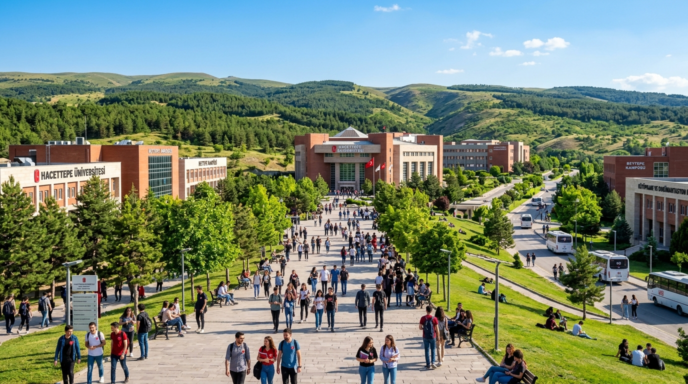
</p>

* **Şehir / İlçe:** Ankara / Çankaya
* **Tür:** Devlet Araştırma Üniversitesi
* **Öğrenci Dostu Puanı:** ⭐️⭐️⭐️⭐️☆ (4.5 / 5.0)
* **Ulaşım:** M2 Çayyolu Metrosu (Beytepe Durağı) önünden kalkan ekspres körüklü EGO ring otobüsleri doğrudan kampüs içine girer.
* **Barınma & Yaşam:** Kampüs sınırları içinde devasa Emine Şerife Hanım KYK Yurdu ve Hacettepe Öğrenci Evleri bulunur; Yeşil Vadi ve BAM Çarşısı sosyal merkezdir.
* **Karakteristik Ruh:** Çam ormanları ile çevrili ferah yayla havası, vize haftalarında 7/24 hizmet veren devasa Merkez Kütüphanesi ve güçlü Tıp/Mühendislik/Edebiyat ekolü.
* 💬 **Öğrenci Tavsiyesi:** *"Beytepe'de Ankara merkezde hava günlük güneşlikken bile serin bir rüzgar eser, çantanda daima bir hırka bulundur. Kütüphanede sabahlayıp BAM'da sıcak simit-çay yapmak buranın klasiğidir!"*
* 📖 [**Tam Hacettepe Beytepe Kampüs Rehberini Oku ➔**](./iller/06-Ankara/Cankaya/Hacettepe-Universitesi-Beytepe-Kampusu.md)

---

### 5. 🏛️ İhsan Doğramacı Bilkent Üniversitesi - Merkez Kampüsü (Ankara / Çankaya)

<p align="center">
  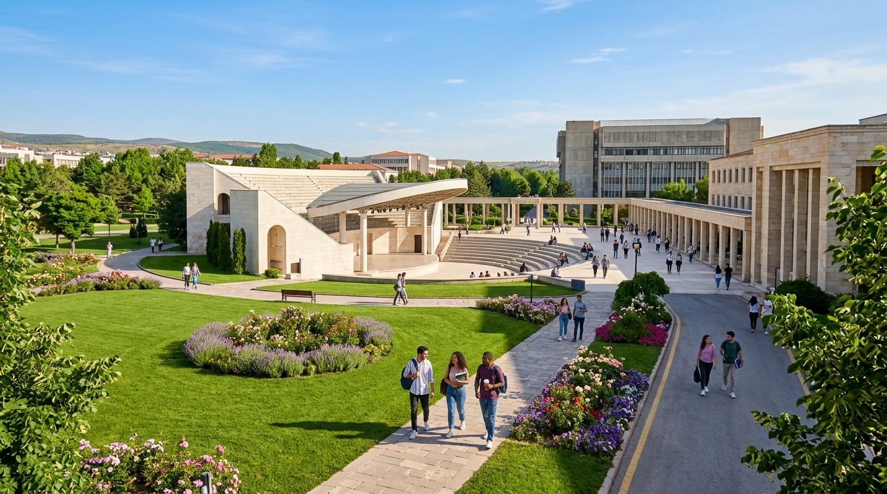
</p>

* **Şehir / İlçe:** Ankara / Çankaya
* **Tür:** Vakıf Üniversitesi
* **Öğrenci Dostu Puanı:** ⭐️⭐️⭐️⭐️⭐️ (4.8 / 5.0)
* **Ulaşım:** Tunalı Hilmi, Sıhhiye ve Bahçelievler güzergahlarından gün boyu kalkan ücretsiz Bilkent ring servisleri ile kolay ulaşım.
* **Barınma & Yaşam:** Kampüs içinde otel konforunda 26 yurt binası mevcuttur; Bilkent Center ve Ankuva AVM kampüse yürüme mesafesindedir.
* **Karakteristik Ruh:** Türkiye'nin ilk vakıf üniversitesi olmanın getirdiği yüksek kurumsal standartlar, Odeon Amfi Tiyatrosu, uluslararası düzeyde akademik yayın performansı ve düzenli peyzaj.
* 💬 **Öğrenci Tavsiyesi:** *"Bilkent'te akademik tempo yoğundur ancak kütüphane ve laboratuvar imkanları kusursuzdur. Çim amfide düzenlenen açık hava konserlerini ve bahar şenliklerini kaçırma!"*
* 📖 [**Tam Bilkent Üniversitesi Kampüs Rehberini Oku ➔**](./iller/06-Ankara/Cankaya/Bilkent-Universitesi-Merkez-Kampusu.md)

---

### 6. 🌲 Koç Üniversitesi - Rumelifeneri Ana Kampüsü (İstanbul / Sarıyer)

<p align="center">
  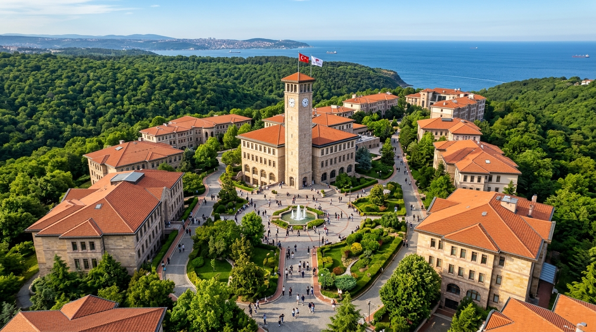
</p>

* **Şehir / İlçe:** İstanbul / Sarıyer
* **Tür:** Vakıf Üniversitesi
* **Öğrenci Dostu Puanı:** ⭐️⭐️⭐️⭐️⭐️ (4.9 / 5.0)
* **Ulaşım:** M2 Hacıosman Metrosu'ndan kalkan 154 İETT ve üniversite ring servisleri ile Kuzey Ormanları içinden ulaşılır.
* **Barınma & Yaşam:** Öğrencilerin %70'inden fazlası kampüs içindeki modern yurtlarda konaklar; kampüs içinde buz pateni pisti, olimpik kapalı havuz ve market yer alır.
* **Karakteristik Ruh:** Karadeniz ve Sarıyer ormanlarının kesiştiği noktada neoklasik Selçuklu/Osmanlı taş mimarisi, Suna Kıraç Kütüphanesi kule saati ve dünya çapında bilimsel yayın üretimi.
* 💬 **Öğrenci Tavsiyesi:** *"Şehir karmaşasından uzakta tamamen izole bir Amerikan kampüsü havası arıyorsan burası tam sana göre. 7/24 açık kütüphanesi ve hoca-öğrenci etkileşimi benzersizdir!"*
* 📖 [**Tam Koç Üniversitesi Kampüs Rehberini Oku ➔**](./iller/34-Istanbul/Sariyer/Koc-Universitesi-Rumelifeneri-Kampusu.md)

---

### 7. 🌴 Ege Üniversitesi - Bornova Merkez Kampüsü (İzmir / Bornova)

<p align="center">
  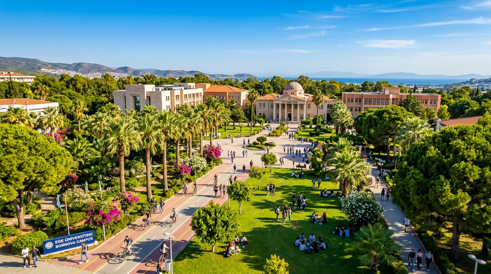
</p>

* **Şehir / İlçe:** İzmir / Bornova
* **Tür:** Devlet Araştırma Üniversitesi
* **Öğrenci Dostu Puanı:** ⭐️⭐️⭐️⭐️⭐️ (5.0 / 5.0)
* **Ulaşım:** Türkiye'de içinden doğrudan metro geçen nadir yerleşkelerdendir. **Ege Üniversitesi Metro İstasyonu** kütüphane ve yemekhanenin tam kalbine açılır.
* **Barınma & Yaşam:** Kampüs içinde Ege KYK Yurdu ve Öğrenci Köyü bulunur; Küçükpark Kafeler Sokağı ve Büyükpark kampüsün hemen karşısındadır.
* **Karakteristik Ruh:** Palmiyeler ve botanik bahçeleriyle bezeli ılıman Ege iklimi, Tıp ve Ziraat fakültelerinin devasa birikimi ve 24 saat yaşayan canlı öğrenci kültürü.
* 💬 **Öğrenci Tavsiyesi:** *"Küçükpark'ta kahveni içip tek adımla kampüse girmek, metroyla 15 dakikada Alsancak Kordon'a inmek paha biçilemez bir lükstür. Ege'de okumak bir yaşam tarzıdır!"*
* 📖 [**Tam Ege Üniversitesi Kampüs Rehberini Oku ➔**](./iller/35-Izmir/Bornova/Ege-Universitesi-Bornova-Kampusu.md)

---

### 8. 🏰 Yıldız Teknik Üniversitesi (YTÜ) - Davutpaşa Kampüsü (İstanbul / Esenler)

<p align="center">
  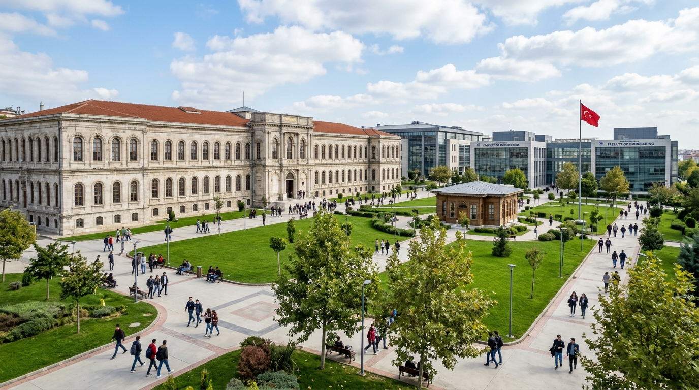
</p>

* **Şehir / İlçe:** İstanbul / Esenler & Güngören Sınırı
* **Tür:** Devlet Teknik Araştırma Üniversitesi
* **Öğrenci Dostu Puanı:** ⭐️⭐️⭐️⭐️⭐️ (4.6 / 5.0)
* **Ulaşım:** M1A Yenikapı-Atatürk Havalimanı Metrosu (**YTÜ-Davutpaşa İstasyonu**) kampüs kapısındadır; metrobüs Cevizlibağ durağından ringlerle 5 dakikada varılır.
* **Barınma & Yaşam:** Kampüs arazisi içinde FSM KYK Kız ve Erkek Yurtları yer alır; Cevizlibağ öğrenci aksına çok yakındır.
* **Karakteristik Ruh:** Osmanlı ordugahı olan tarihi kışla taş binaları, Otağ-ı Hümayun padişah köşkü, 1.3 milyon metrekarelik devasa yeşil vaha ve YTÜ Yıldız Teknopark.
* 💬 **Öğrenci Tavsiyesi:** *"İstanbul'da hem köklü bir teknik üniversitede okuyup hem de barınma derdi çekmek istemiyorsan Davutpaşa biçilmiş kaftandır. Tarihi Taş Bina avlusunda çay içmeden mezun olma!"*
* 📖 [**Tam YTÜ Davutpaşa Kampüs Rehberini Oku ➔**](./iller/34-Istanbul/Esenler/Yildiz-Teknik-Universitesi-Davutpasa-ve-Yildiz-Kampusleri.md)

---

### 9. 🏔️ Bursa Uludağ Üniversitesi (BUÜ) - Görükle Merkez Kampüsü (Bursa / Nilüfer)

<p align="center">
  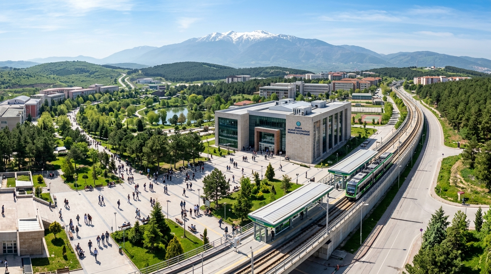
</p>

* **Şehir / İlçe:** Bursa / Nilüfer (Görükle)
* **Tür:** Devlet Araştırma Üniversitesi
* **Öğrenci Dostu Puanı:** ⭐️⭐️⭐️⭐️⭐️ (4.6 / 5.0)
* **Ulaşım:** Bursaray hafif raylı sisteminin son durağı (**Üniversite İstasyonu**) kampüs nizamiyesindedir.
* **Barınma & Yaşam:** Kampüsün hemen bitişiğindeki **Görükle Yerleşimi**, Türkiye'nin en büyük bağımsız öğrenci kasabasıdır; on binlerce öğrenci apartı ve kafe yürüme mesafesindedir.
* **Karakteristik Ruh:** Uludağ manzaralı çam ormanları, devasa Tıp Fakültesi Hastanesi, gölet çevresi ve kampüsten çıkınca tamamen gençlerin yönettiği Görükle sosyal hayatı.
* 💬 **Öğrenci Tavsiyesi:** *"Görükle'de yaşamak bambaşka bir histir; gece 02:00'de bile sokaklarda öğrenciler ders notu fotokopisi çektirip çorba içer. Hafta sonu da Bursaray'a atlayıp Mudanya sahiline inebilirsin!"*
* 📖 [**Tam Bursa Uludağ Üniversitesi Görükle Rehberini Oku ➔**](./iller/16-Bursa/Nilufer/Bursa-Uludag-Universitesi-Gorukle-Merkez-Kampusu.md)

---

### 10. 🌊 Karadeniz Teknik Üniversitesi (KTÜ) - Kanuni Merkez Kampüsü (Trabzon / Ortahisar)

<p align="center">
  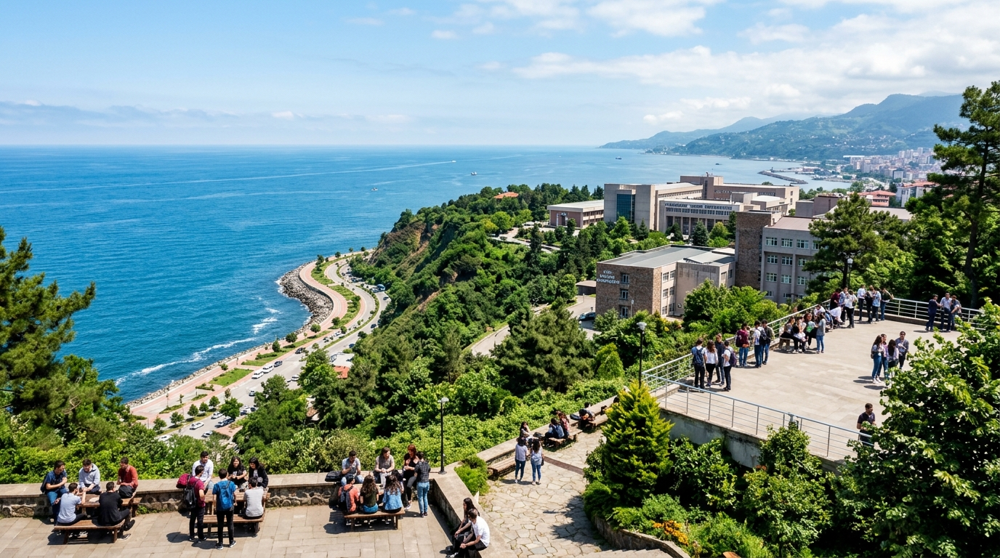
</p>

* **Şehir / İlçe:** Trabzon / Ortahisar
* **Tür:** Devlet Araştırma Üniversitesi
* **Öğrenci Dostu Puanı:** ⭐️⭐️⭐️⭐️⭐️ (4.6 / 5.0)
* **Ulaşım:** Trabzon Havalimanı'na ve Forum AVM'ye yürüme mesafesindedir; Meydan'dan kalkan belediye otobüsleri ve dolmuşlar kampüs içine kadar çıkar.
* **Barınma & Yaşam:** Kampüs içinde ve Kalkınma Mahallesi'nde çok sayıda KYK yurdu bulunur; Kalkınma Caddesi öğrencilerin tüm sosyal ihtiyaçlarını karşılar.
* **Karakteristik Ruh:** Karadeniz manzaralı sahil terasları, botanik bahçesi gibi yeşil peyzaj, 1955'ten bu yana süregelen Doğu Karadeniz'in ilk teknik üniversitesi gururu ve Aslanlı Yol.
* 💬 **Öğrenci Tavsiyesi:** *"KTÜ'de okumak deniz havasını ciğerlerine çekerek mühendislik öğrenmektir. Kampüsün A kapısından çıkıp Forum'a, C kapısından çıkıp Kalkınma'ya yürümek buranın en büyük kolaylığıdır!"*
* 📖 [**Tam KTÜ Kanuni Kampüs Rehberini Oku ➔**](./iller/61-Trabzon/Ortahisar/KTU-Merkez.md)

---


---

## ⚠️ Tercih Yapmadan Önce Okuyun: Kampüslerin Kronik Sorunları ve Olumsuz Öğrenci Yorumları

> 📢 **"Resmi kataloglar binaları gösterir, açık kaynak kültürü ise o binaların içindeki gerçeği anlatır."**  
> Bu bölüm; Ekşi Sözlük, Reddit, X (Twitter) ve üniversite itiraf sayfalarında öğrencilerin en çok yakındığı, resmi tanıtım günlerinde asla bahsedilmeyen **kronik sorunları ve olumsuz yorumları** şeffaflıkla belgeler.

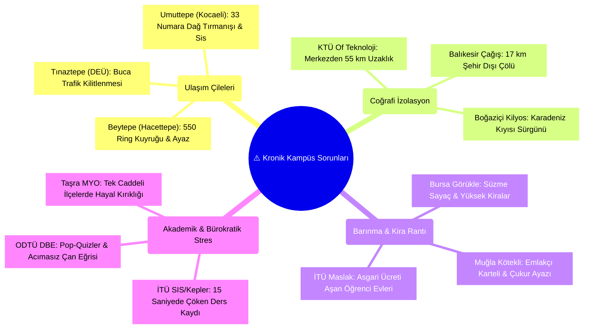

---

### 1. 🚌 Ulaşım ve Ring Seferlerindeki Kronik Çileler

* **Hacettepe Beytepe - "550 Numaralı Ring Sınavı":**  
  Kampüs dışında (Kızılay, Bahçelievler, Eryaman) yaşayan öğrenciler için her sabah Beytepe Köprüsü metro çıkışında başlayan dondurucu sıra. 08:00 - 09:15 saatleri arasında yüzlerce metreyi bulan kuyrukta körüklü otobüse binebilmek için kış ayazında 30-45 dakika titremek Beytepe öğrenciliğinin en yıpratıcı rutinidir.
* **Kocaeli Umuttepe - "33 Numara ile Dağa Tırmanış":**  
  İzmit merkezden Umuttepe'ye çıkan otobüslerin dik Santral yokuşunda balık istifi tırmanması, aşırı motor gürültüsü ve kışın İzmit'te hava açıkken Umuttepe'de görüşün 5 metreye indiği dondurucu sis ve tipi. Yollar buzlandığında sınavların son anda ertelenmesi veya mahsur kalınması olağandır.
* **Dokuz Eylül Üniversitesi - "Buca Trafiği ve Tınaztepe Rampası":**  
  Şirinyer ile Tınaztepe arasındaki 5 kilometrelik mesafenin sabah saatlerinde dar sokaklar ve Heykel kavşağı trafiği yüzünden 50 dakikayı bulması. Tınaztepe'nin dik rampalarında yazın 40 derece İzmir sıcağında kan ter içinde amfi aramak.
* **Eskişehir Teknik Üniversitesi (ESTÜ) - "Eskişehir'de Tramvaysız Kalmak":**  
  Eskişehir denildiğinde akla gelen tramvay konforunun ESTÜ İki Eylül Kampüsü'nde bulunmaması. Espark önündeki Kırmızı 4 ve Siyah 4 duraklarında sabahları oluşan 100 metrelik kuyruklar ve Hasan Polatkan Havalimanı pistinin kenarında esen meşhur dondurucu "ESTÜ ayazı".

---

### 2. 🗺️ Coğrafi İzolasyon ve "Taşra Sürgünleri"

* **KTÜ Of Teknoloji Fakültesi - "KTÜ Diye Tercih Edip 55 KM Uzağa Gitmek":**  
  YKS kılavuzunda "Karadeniz Teknik Üniversitesi" ibaresini görüp Trabzon merkez kampüsüne gideceğini zanneden adayların en büyük şoku. Of ilçesi Trabzon merkeze tam 55 km uzaklıktadır; ilçede sosyal yaşam tek bir cadde, çay ocakları ve sınırlı sayıda lokantadan ibarettir.
* **Balıkesir Üniversitesi Çağış Kampüsü - "Şehirden 17 KM Uzakta Bozkır":**  
  Şehir merkezine 17 km uzaklıktaki Çağış Kampüsü'nde eğitim bittiğinde akşam 18:00'den sonra hayat tamamen durur. Şehir merkezinden kalkan halk otobüslerinde tek biniş ücretleri Türkiye ortalamasının üzerindedir ve yolculuk 40 dakika sürer.
* **Boğaziçi Üniversitesi Kilyos (Sarıtepe) Kampüsü:**  
  İstanbul'un kalbinde okuyacağını sanan hazırlık öğrencilerinin kendilerini Karadeniz kıyısında, Beşiktaş'a 35 km uzaklıkta, kışın fırtına ve rüzgardan yürünemeyen izole bir sahil kampüsünde bulması.
* **İYTE Gülbahçe (İzmir) - "İzmir Diye Tercih Edip Urla Köyüne Düşmek":**  
  İzmir kent merkezine (Konak/Alsancak) tam 50 km mesafede, Gülbahçe Köyü sahilinde yer alır. Şehre gitmek git-gel 3-4 saati bulduğundan öğrenciler adeta köye hapsolur; rüzgar sörfü için ideal olan sert fırtınalar kışın kampüste yürümeyi imkansız kılar.
* **Koç & Sabancı Üniversiteleri - "Altın Kafes İzolasyonu":**  
  Sarıyer'in kuzey ormanlarına gömülü Koç Rumelifeneri ile Tuzla/Kocaeli sınırındaki Sabancı Orhanlı kampüsleri, İstanbul merkezinden (Kadıköy/Taksim) 40-55 km uzaktadır. Özel servislere (shuttle) mahkumiyet, yüksek yaşam maliyeti ve şehre inmenin lojistik çilesi öğrencileri kapalı bir ada hayatına mahkum eder.

---

### 3. 💸 Barınma Krizleri ve Fahiş Kira Rantları

* **Muğla Kötekli - "Kira Karteli ve Çukur Ayazı":**  
  Tamamen öğrencilere tahsis edilen Kötekli bölgesinde ev sahipleri ve emlakçıların 1+1 apartlara turizm bölgesi tarifesi uygulaması, depozito iadelerinde çıkarılan zorluklar. Ayrıca Kötekli çukurda yer aldığı için kışın dondurucu bir ayaz ve kömür dumanı solunur.
* **Bursa Görükle - "Bursaray Görükle'ye Girmiyor!":**  
  Bursaray raylı sistemi Görükle yerleşimine girmez; yalnızca kampüs kapısında son bulur. Görükle'de ev tutan öğrenci metroya ve fakültesine gitmek için her gün ek minibüs ücreti ödemek veya 25 dakika rüzgara karşı yürümek zorundadır.
* **Bodrum, Fethiye ve Marmaris Meslek Yüksekokulları:**  
  Turizm merkezlerindeki fakülte ve MYO'ları kazanan öğrencilerin asgari ücreti aşan ev kiraları ve yetersiz yurt kapasiteleri sebebiyle kayıtlarını dondurmak veya okula gitmeden uzaktan sınavlara girmek zorunda kalması.

---

### 4. 📚 Akademik Tükenmişlik ve Bürokrasi Engelleri

* **İTÜ - "CRN Ders Seçim Savaşları (Açlık Oyunları)":**  
  Ders seçim sisteminin (SIS/Kepler) açıldığı ilk 15 saniye içinde sunucuların çökmesi; zorunlu havuz derslerinin saniyeler içinde tükenmesi sebebiyle öğrencilerin dönem uzatmak zorunda kalması ve dönem başlarında yaşanan yoğun stres.
* **ODTÜ - "DBE Pop-Quizleri ve Acımasız Çan Eğrisi":**  
  Hazırlık okulunda (DBE) her hafta yapılan habersiz sınavlar ve bölümlerdeki ağır çan eğrisi yüzünden 4 yıllık bölümlerin 5-6 yılda bitirilmesinin olağan hale gelmesi.
* **İlçe MYO'ları Gerçeği - "Beklenti vs. Gerçek":**  
  Taşradaki küçük ilçe meslek yüksekokullarına giden öğrencilerin "kampüs hayatı" yerine tek katlı bir bina, 2 kahvehane ve akşam 19:00'da kepenk indiren sessiz bir ilçe hayatıyla karşılaşması. Tercih yaparken sadece bölüm adına değil, **ilçenin haritadaki yerine ve sosyal imkanlarına** mutlaka bakılmalıdır!

---

## 🗺️ 81 İl Bölge Bazlı Kampüs İndeksi

Aşağıdaki bölge sekmelerinden ilgilendiğiniz ili seçerek o şehrin genel öğrenci profilini ve ilçe/kampüs detaylarını inceleyebilirsiniz:

<details open>
<summary><strong>🌊 Marmara Bölgesi (11 İl)</strong></summary>

| Plaka | İl Klasörü | Başlıca Üniversiteler | Öne Çıkan Bölgeler |
| :---: | :--- | :--- | :--- |
| **10** | [📂 10-Balikesir](./iller/10-Balikesir/README.md) | Balıkesir Üni. (BAÜN), Bandırma Onyedi Eylül Üni. | Çağış Kampüsü, Bahçelievler, Bandırma |
| **11** | [📂 11-Bilecik](./iller/11-Bilecik/README.md) | Bilecik Şeyh Edebali Üniversitesi | Gülümbe Kampüsü, Pelitözü, Bozüyük |
| **16** | [📂 16-Bursa](./iller/16-Bursa/README.md) | Bursa Uludağ Üni., Bursa Teknik Üni. (BTÜ), Mudanya Üni. | Görükle, Mimar Sinan, İnegöl |
| **17** | [📂 17-Canakkale](./iller/17-Canakkale/README.md) | Çanakkale Onsekiz Mart Üni. (ÇOMÜ) | Terzioğlu, Barbaros, Kepez, Biga |
| **22** | [📂 22-Edirne](./iller/22-Edirne/README.md) | Trakya Üniversitesi | Balkan Yerleşkesi, Ayşekadın, Keşan |
| **34** | [📂 34-Istanbul](./iller/34-Istanbul/README.md) | İTÜ, Boğaziçi, YTÜ, İÜ, İÜC, Marmara, GSÜ, Koç, Sabancı vb. | Ayazağa, Davutpaşa, Beyazıt, Kadıköy, Maltepe |
| **39** | [📂 39-Kirklareli](./iller/39-Kirklareli/README.md) | Kırklareli Üniversitesi | Kayalı Kampüsü, Lüleburgaz |
| **41** | [📂 41-Kocaeli](./iller/41-Kocaeli/README.md) | Kocaeli Üni. (KOÜ), Gebze Teknik Üni. (GTÜ) | Umuttepe, İzmit Merkez, Gebze Çayırova |
| **54** | [📂 54-Sakarya](./iller/54-Sakarya/README.md) | Sakarya Üni. (SAÜ), Sakarya Uygulamalı Bilimler Üni. | Esentepe Kampüsü, Serdivan (Mavi Durak) |
| **59** | [📂 59-Tekirdag](./iller/59-Tekirdag/README.md) | Tekirdağ Namık Kemal Üniversitesi | Değirmenaltı, Çorlu Mühendislik |
| **77** | [📂 77-Yalova](./iller/77-Yalova/README.md) | Yalova Üniversitesi | Merkez Yerleşke, Çınarcık |

</details>

<details>
<summary><strong>🌿 Ege Bölgesi (8 İl)</strong></summary>

| Plaka | İl Klasörü | Başlıca Üniversiteler | Öne Çıkan Bölgeler |
| :---: | :--- | :--- | :--- |
| **09** | [📂 09-Aydin](./iller/09-Aydin/README.md) | Aydın Adnan Menderes Üniversitesi (ADÜ) | Aytepe (Efeler), Nazilli İsabeyli, Kuşadası |
| **20** | [📂 20-Denizli](./iller/20-Denizli/README.md) | Pamukkale Üniversitesi (PAÜ) | Kınıklı Kampüsü, Asmalıevler, Bağbaşı |
| **35** | [📂 35-Izmir](./iller/35-Izmir/README.md) | Ege Üni., Dokuz Eylül, İYTE, İKÇÜ, Bakırçay, Ekonomi, Yaşar | Bornova (Küçükpark), Buca (Tınaztepe), Urla |
| **43** | [📂 43-Kutahya](./iller/43-Kutahya/README.md) | Kütahya Dumlupınar Üni., Kütahya Sağlık Bilimleri | Evliya Çelebi Kampüsü, Germiyan, Tavşanlı |
| **45** | [📂 45-Manisa](./iller/45-Manisa/README.md) | Manisa Celal Bayar Üniversitesi (MCBÜ) | Muradiye Kampüsü, Uncubozköy, Turgutlu |
| **48** | [📂 48-Mugla](./iller/48-Mugla/README.md) | Muğla Sıtkı Koçman Üniversitesi (MSKÜ) | Kötekli (Menteşe), Bodrum, Fethiye, Marmaris |
| **64** | [📂 64-Usak](./iller/64-Usak/README.md) | Uşak Üniversitesi | Bir Eylül Kampüsü, Kemalöz |
| **35** | [📂 35-Izmir](./iller/35-Izmir/README.md) | Ege, DEÜ, İYTE, İKÇÜ, Bakırçay, Ekonomi, Demokrasi | Bornova, Buca, Urla Gülbahçe, Çiğli |

</details>

<details>
<summary><strong>🏛️ İç Anadolu Bölgesi (13 İl)</strong></summary>

| Plaka | İl Klasörü | Başlıca Üniversiteler | Öne Çıkan Bölgeler |
| :---: | :--- | :--- | :--- |
| **06** | [📂 06-Ankara](./iller/06-Ankara/README.md) | ODTÜ, Hacettepe, Ankara Üni., Gazi, AYBÜ, Bilkent, TOBB ETÜ | Çankaya, Beytepe, Beşevler, Cebeci, 100. Yıl |
| **18** | [📂 18-Cankiri](./iller/18-Cankiri/README.md) | Çankırı Karatekin Üniversitesi | Uluyazı Kampüsü, Kırkevler |
| **26** | [📂 26-Eskisehir](./iller/26-Eskisehir/README.md) | Anadolu Üni., Eskişehir Osmangazi Üni., ESTÜ | Bağlar, Meşelik (Odunpazarı), İki Eylül |
| **38** | [📂 38-Kayseri](./iller/38-Kayseri/README.md) | Erciyes Üni. (ERÜ), Abdullah Gül Üni. (AGÜ), Kayseri Üni. | Talas, Melikgazi, Sümer Kampüsü |
| **40** | [📂 40-Kirsehir](./iller/40-Kirsehir/README.md) | Kırşehir Ahi Evran Üniversitesi | Bağbaşı Kampüsü, Cacabey |
| **42** | [📂 42-Konya](./iller/42-Konya/README.md) | Selçuk Üni., Necmettin Erbakan Üni., Konya Teknik Üni. | Bosna Hersek (Selçuklu), Köyceğiz (Meram) |
| **50** | [📂 50-Nevsehir](./iller/50-Nevsehir/README.md) | Nevşehir Hacı Bektaş Veli Üni., Kapadokya Üni. | 2000 Evler, Ürgüp Mustafapaşa |
| **51** | [📂 51-Nigde](./iller/51-Nigde/README.md) | Niğde Ömer Halisdemir Üniversitesi | Bor Yolu Kampüsü, Aşağı Kayabaşı |
| **58** | [📂 58-Sivas](./iller/58-Sivas/README.md) | Sivas Cumhuriyet Üni., Sivas Bilim ve Teknoloji Üni. | Merkez Kampüs, Yenişehir |
| **66** | [📂 66-Yozgat](./iller/66-Yozgat/README.md) | Yozgat Bozok Üniversitesi | Erdoğan Akdağ Kampüsü |
| **68** | [📂 68-Aksaray](./iller/68-Aksaray/README.md) | Aksaray Üniversitesi | Adana Yolu Kampüsü, Kafeler Caddesi |
| **70** | [📂 70-Karaman](./iller/70-Karaman/README.md) | Karamanoğlu Mehmetbey Üniversitesi | Yunus Emre Kampüsü |
| **71** | [📂 71-Kirikkale](./iller/71-Kirikkale/README.md) | Kırıkkale Üniversitesi (KKÜ) | Yahşihan Merkez Kampüsü, Yenişehir |

</details>

<details>
<summary><strong>🌴 Akdeniz Bölgesi (8 İl)</strong></summary>

| Plaka | İl Klasörü | Başlıca Üniversiteler | Öne Çıkan Bölgeler |
| :---: | :--- | :--- | :--- |
| **01** | [📂 01-Adana](./iller/01-Adana/README.md) | Çukurova Üni., Adana Alparslan Türkeş BTÜ | Balcalı, Barajyolu, Sarıçam |
| **07** | [📂 07-Antalya](./iller/07-Antalya/README.md) | Akdeniz Üni., ALKÜ, Antalya Bilim Üni. | Kültür Mahallesi, Meltem, Alanya Kestel |
| **15** | [📂 15-Burdur](./iller/15-Burdur/README.md) | Burdur Mehmet Akif Ersoy Üni. (MAKÜ) | İstiklal Yerleşkesi, Bucak |
| **31** | [📂 31-Hatay](./iller/31-Hatay/README.md) | Hatay Mustafa Kemal Üni., İskenderun Teknik Üni. | Tayfur Sökmen, İskenderun Merkez |
| **32** | [📂 32-Isparta](./iller/32-Isparta/README.md) | Süleyman Demirel Üni., Isparta Uygulamalı Bilimler | Çünür Doğu/Batı Kampüsü, Fatih Mah. |
| **33** | [📂 33-Mersin](./iller/33-Mersin/README.md) | Mersin Üni. (MEÜ), Tarsus Üni., Toros, Çağ | Çiftlikköy, Üniversite Caddesi, Tarsus |
| **46** | [📂 46-Kahramanmaras](./iller/46-Kahramanmaras/README.md) | Kahramanmaraş Sütçü İmam Üni., İstiklal Üni. | Avşar Kampüsü, Karacasu |
| **80** | [📂 80-Osmaniye](./iller/80-Osmaniye/README.md) | Osmaniye Korkut Ata Üniversitesi | Karacaoğlan Kampüsü (Fakıuşağı) |

</details>

<details>
<summary><strong>🌲 Karadeniz Bölgesi (18 İl)</strong></summary>

| Plaka | İl Klasörü | Başlıca Üniversiteler | Öne Çıkan Bölgeler |
| :---: | :--- | :--- | :--- |
| **05** | [📂 05-Amasya](./iller/05-Amasya/README.md) | Amasya Üniversitesi | İpekköy, Yeşilırmak, Merzifon |
| **08** | [📂 08-Artvin](./iller/08-Artvin/README.md) | Artvin Çoruh Üniversitesi | Seyitler Kampüsü, Hopa |
| **14** | [📂 14-Bolu](./iller/14-Bolu/README.md) | Bolu Abant İzzet Baysal Üniversitesi | Gölköy Kampüsü, İzzet Baysal Cad. |
| **19** | [📂 19-Corum](./iller/19-Corum/README.md) | Hitit Üniversitesi | Kuzey Kampüsü, Güney Kampüsü |
| **28** | [📂 28-Giresun](./iller/28-Giresun/README.md) | Giresun Üniversitesi | Güre Yerleşkesi, Tirebolu |
| **29** | [📂 29-Gumushane](./iller/29-Gumushane/README.md) | Gümüşhane Üniversitesi | Bağlarbaşı Kampüsü |
| **37** | [📂 37-Kastamonu](./iller/37-Kastamonu/README.md) | Kastamonu Üniversitesi | Kuzeykent Kampüsü |
| **52** | [📂 52-Ordu](./iller/52-Ordu/README.md) | Ordu Üniversitesi | Cumhuriyet Kampüsü, Ünye, Fatsa |
| **53** | [📂 53-Rize](./iller/53-Rize/README.md) | Recep Tayyip Erdoğan Üniversitesi | Zihni Derin (Fener), Çayeli |
| **55** | [📂 55-Samsun](./iller/55-Samsun/README.md) | Ondokuz Mayıs Üni. (OMÜ), Samsun Üni. | Kurupelit (Atakum), Ballıca |
| **57** | [📂 57-Sinop](./iller/57-Sinop/README.md) | Sinop Üniversitesi | Osmaniye/Korucuk Kampüsü |
| **60** | [📂 60-Tokat](./iller/60-Tokat/README.md) | Tokat Gaziosmanpaşa Üniversitesi | Taşlıçiftlik Kampüsü |
| **61** | [📂 61-Trabzon](./iller/61-Trabzon/README.md) | Karadeniz Teknik Üni. (KTÜ), Trabzon Üni. | Kanuni (Kalkınma), Akçaabat, Of |
| **67** | [📂 67-Zonguldak](./iller/67-Zonguldak/README.md) | Zonguldak Bülent Ecevit Üniversitesi | Farabi (İncivez), Kdz. Ereğli |
| **69** | [📂 69-Bayburt](./iller/69-Bayburt/README.md) | Bayburt Üniversitesi | Dede Korkut Kampüsü, Baberti |
| **74** | [📂 74-Bartin](./iller/74-Bartin/README.md) | Bartın Üniversitesi | Kutlubey Kampüsü, Ağdacı |
| **78** | [📂 78-Karabuk](./iller/78-Karabuk/README.md) | Karabük Üniversitesi (KBÜ) | Demir Çelik Kampüsü, 100. Yıl |
| **81** | [📂 81-Duzce](./iller/81-Duzce/README.md) | Düzce Üniversitesi | Konuralp Merkez Kampüsü, Akçakoca |

</details>

<details>
<summary><strong>🏔️ Doğu Anadolu Bölgesi (14 İl)</strong></summary>

| Plaka | İl Klasörü | Başlıca Üniversiteler | Öne Çıkan Bölgeler |
| :---: | :--- | :--- | :--- |
| **04** | [📂 04-Agri](./iller/04-Agri/README.md) | Ağrı İbrahim Çeçen Üniversitesi | Merkez Kampüs |
| **12** | [📂 12-Bingol](./iller/12-Bingol/README.md) | Bingöl Üniversitesi | Selahaddin-i Eyyubi Mah. |
| **13** | [📂 13-Bitlis](./iller/13-Bitlis/README.md) | Bitlis Eren Üniversitesi | Rahva Merkez Kampüsü, Tatvan |
| **23** | [📂 23-Elazig](./iller/23-Elazig/README.md) | Fırat Üniversitesi | Üniversite Mahallesi, Sürsürü |
| **24** | [📂 24-Erzincan](./iller/24-Erzincan/README.md) | Erzincan Binali Yıldırım Üniversitesi | Yalnızbağ Yerleşkesi |
| **25** | [📂 25-Erzurum](./iller/25-Erzurum/README.md) | Atatürk Üni., Erzurum Teknik Üni. (ETÜ) | Yakutiye Merkez Kampüs, Yıldızkent |
| **30** | [📂 30-Hakkari](./iller/30-Hakkari/README.md) | Hakkari Üniversitesi | Zeynel Bey Kampüsü |
| **36** | [📂 36-Kars](./iller/36-Kars/README.md) | Kafkas Üniversitesi | Paşaçayırı Kampüsü, Sarıkamış |
| **44** | [📂 44-Malatya](./iller/44-Malatya/README.md) | İnönü Üni., Malatya Turgut Özal Üni. | Battalgazi (Bulgurlu), Yeşilyurt |
| **49** | [📂 49-Mus](./iller/49-Mus/README.md) | Muş Alparslan Üniversitesi | Güzeltepe Kampüsü |
| **62** | [📂 62-Tunceli](./iller/62-Tunceli/README.md) | Munzur Üniversitesi | Aktuluk Yerleşkesi, Pertek |
| **65** | [📂 65-Van](./iller/65-Van/README.md) | Van Yüzüncü Yıl Üniversitesi | Zeve Kampüsü (Tuşba) |
| **75** | [📂 75-Ardahan](./iller/75-Ardahan/README.md) | Ardahan Üniversitesi | Yenisey Kampüsü |
| **76** | [📂 76-Igdir](./iller/76-Igdir/README.md) | Iğdır Üniversitesi | Suveren Kampüsü, Karaağaç |

</details>

<details>
<summary><strong>☀️ Güneydoğu Anadolu Bölgesi (9 İl)</strong></summary>

| Plaka | İl Klasörü | Başlıca Üniversiteler | Öne Çıkan Bölgeler |
| :---: | :--- | :--- | :--- |
| **02** | [📂 02-Adiyaman](./iller/02-Adiyaman/README.md) | Adıyaman Üniversitesi | Altınşehir Mahallesi |
| **21** | [📂 21-Diyarbakir](./iller/21-Diyarbakir/README.md) | Dicle Üniversitesi | Sur Kampüsü, Kayapınar |
| **27** | [📂 27-Gaziantep](./iller/27-Gaziantep/README.md) | Gaziantep Üni. (GAÜN), GİBTÜ, Hasan Kalyoncu | Üniversite Bulvarı, Karataş |
| **47** | [📂 47-Mardin](./iller/47-Mardin/README.md) | Mardin Artuklu Üniversitesi | Artuklu Kampüsü, Midyat |
| **56** | [📂 56-Siirt](./iller/56-Siirt/README.md) | Siirt Üniversitesi | Kezer Yerleşkesi |
| **63** | [📂 63-Sanliurfa](./iller/63-Sanliurfa/README.md) | Harran Üniversitesi | Osmanbey Kampüsü, Eyyübiye |
| **72** | [📂 72-Batman](./iller/72-Batman/README.md) | Batman Üniversitesi | Batı Raman Kampüsü, Merkez |
| **73** | [📂 73-Sirnak](./iller/73-Sirnak/README.md) | Şırnak Üniversitesi | Mehmet Emin Acar Kampüsü |
| **79** | [📂 79-Kilis](./iller/79-Kilis/README.md) | Kilis 7 Aralık Üniversitesi | Merkez Kampüs, Karataş |

</details>

---

## 🔍 İçerik Standartları: Bir Kampüs Rehberinde Neler Var?

Her yerleşke dosyası [`TEMPLATE.md`](./TEMPLATE.md) şablonundaki standart metrikleri içerir:

1. **🚇 Ulaşım Ağı ve Erişilebilirlik:** Şehir merkezine mesafe, ring seferleri, metro/tramvay entegrasyonu, öğrenci abonman ücretleri ve kış koşullarında ulaşım.
2. **🏠 Barınma ve Yurtlar:** KYK yurtlarının kapasitesi ve konumu, özel yurt fiyat bantları, popüler öğrenci mahalleleri ve güncel kira ortalamaları.
3. **🎓 Akademik & Fiziki Altyapı:** Kütüphane kapasitesi (Vize/final haftası 7/24 açık mı?), laboratuvar/atölye imkanları, internet (`eduroam`) hızı ve öğrenci kulüpleri.
4. **🍽️ Beslenme ve Kampüs Hayatı:** Yemekhane ücretleri, porsiyon doyuruculuğu, alternatif kafeteryalar, çarşı ve spor tesisleri.
5. **🌆 Şehir ve İlçe Dinamikleri:** Yerel halkın öğrenciye tutumu, sosyal etkinlikler, doğa/kültür imkanları, part-time iş/staj olanakları.
6. **⚖️ Artılar ve Eksiler:** Filtresiz en büyük avantajlar ve dezavantajlar.
7. **💬 Öğrenci Tavsiyesi:** Bu kampüste okuyan bir üst dönem öğrencisinin samimi ve nokta atışı tavsiyesi.

---

## 🤝 Nasıl Katkıda Bulunabilirim?

Bu repo tamamen açık kaynaktır ve senin deneyimlerine ihtiyacı var! Kendi üniversiteni veya çok iyi bildiğin bir kampüsü ekleyebilirsin. Detaylar için [`CONTRIBUTING.md`](./CONTRIBUTING.md) belgesini inceleyebilirsin.

```bash
# 1. Repoyu klonla
git clone https://github.com/bahattinyunus/turkiye-kampus-rehberi.git
cd turkiye-kampus-rehberi

# 2. Yeni bir dal oluştur
git checkout -b feat/kampus-ekle

# 3. TEMPLATE.md dosyasını ilgili ile kopyalayıp doldur
cp TEMPLATE.md 06-Ankara/Cankaya/Yeni-Kampus.md

# 4. Doğrula ve Commit at
python scripts/cli.py validate
git add .
git commit -m "feat(06-Ankara): Yeni Kampüs Rehberi eklendi"
git push origin feat/kampus-ekle
```

---

## 🚀 Proje Yol Haritası (Roadmap)

- [x] Temel depo mimarisinin ve klasör yapısının (81 İl) oluşturulması.
- [x] Standart Markdown şablonlarının ([`TEMPLATE.md`](./TEMPLATE.md), [`CONTRIBUTING.md`](./CONTRIBUTING.md), [`CODE_OF_CONDUCT.md`](./CODE_OF_CONDUCT.md)) yazılması.
- [x] 81 ilin tamamı için şehir rehberlerinin ve 300+ kampüs analizinin tamamlanması.
- [x] **Web Entegrasyonu (Faz 2):** GitHub Pages üzerinde canlı, filtreleme destekli arama motoru ([`web/index.html`](https://bahattinyunus.github.io/turkiye-kampus-rehberi/)).
- [x] **API ve SDK (Faz 3):** `kampus-rehberi` Python paketi ve yapılandırılmış JSON veritabanı ([`data/kampusler.json`](./data/kampusler.json)).
- [x] **Akıllı Tercih Danışmanı (Faz 4):** Doğal dilde soru sorulabilen AI destekli `TercihDanismani` motoru.
- [ ] **Mobil Uygulama (Faz 5):** React Native / Flutter tabanlı çevrimdışı destekli mobil tercih asistanı.

---

## 📞 İletişim ve Topluluk

* 💡 **Tartışmalar:** Fikirler ve öneriler için [GitHub Discussions](https://github.com/bahattinyunus/turkiye-kampus-rehberi/discussions)
* 🐛 **Hata Bildirimi:** Eksik veya hatalı veriler için [GitHub Issues](https://github.com/bahattinyunus/turkiye-kampus-rehberi/issues)
* 📧 **E-Posta:** `bahattinyunuscetin@hotmail.com`

<p align="center">
  <sub>Türkiye Kampüs Rehberi © 2026. MIT Lisansı ile açık kaynak olarak geliştirilmiştir.</sub><br/>
  <sub><em>"Resmi kataloglar binaları gösterir, açık kaynak kültürü ise o binaların içindeki gerçeği."</em></sub>
</p>
